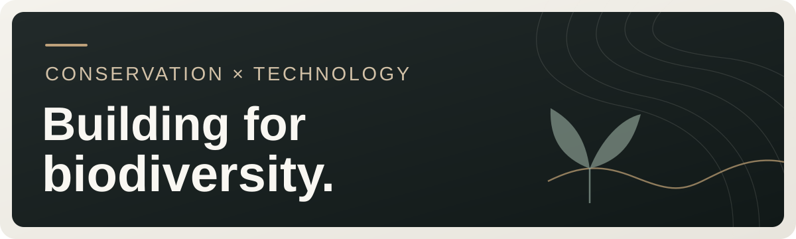

# Mahfuzur Rahman

**Conservation technology · Web engineering · Ecological intelligence**

I design and build digital systems that make biodiversity information more useful to people working for conservation in Bangladesh. My work spans website planning, frontend development, content architecture, and early-stage tools for ecological observation.

## Featured work

### DESCF — public conservation website

I led the website's planning, design, development, and launch for the [Deep Ecology and Snake Conservation Foundation](https://www.descf.org/). The platform connects public education, conservation programmes, field stories, and a searchable guide to the snakes of Bangladesh.

**My contribution:** experience design, Next.js/TypeScript development, Sanity content integration, reusable page structures, and launch.

[**View the website**](https://www.descf.org/) · [**Read the case study**](https://github.com/mahfuzurdescf-coder/descf-website-case-study) · [**Explore species-name search**](https://mahfuzurdescf-coder.github.io/descf-website-case-study/DESCF_Search_Demo.html)

### BODHI — biodiversity observation and intelligence

I am developing **BODHI (Biodiversity Observation and Data for Hyperlocal Intelligence)**, a research initiative exploring how bioacoustics, environmental observations, and satellite-derived information can support local conservation decisions. This work is in development; public examples will be shared as they become ready.

[**Read the BODHI R&D case study**](projects/bodhi-rd.md)

## Areas I work in

- **Web products:** Next.js, React, TypeScript, responsive interfaces, accessible information design
- **Content systems:** Sanity CMS, structured content, multilingual discovery, search interfaces
- **Conservation technology:** biodiversity data workflows, field observations, acoustic and habitat intelligence research

I serve as Chairperson of DESCF and work at the intersection of practical technology and conservation.

**Contact:** [md.mahfuzur.rahman@descf.org](mailto:md.mahfuzur.rahman@descf.org)